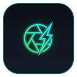

<p align="center">
  
</p>

<h1 align="center">⚡ Network Image Sniffer & AI Toolkit (SniffLens)</h1>

<p align="center">
  <b>High-Performance Chrome & Brave Extension (Manifest V3) for Network Layer Media Interception, Native Hardware Auto-Slide, Multi-Tab Settings Isolation & Vision AI Dataset Preparation.</b>
</p>

<p align="center">
  <a href="./README_TH.md"><b>[ 🇹🇭 อ่านคู่มือเวอร์ชันภาษาไทย (Thai Version) ]</b></a>
</p>

<p align="center">
  
  
  
  
  
  
</p>

---

## 🌟 Key Features

| Feature | Description |
| :--- | :--- |
| **⚡ Network Layer Sniffing** | Intercepts full-resolution image streams (JPEG, PNG, WEBP, SVG, GIF) directly from network traffic. Never misses high-res assets hidden behind overlays. |
| **🎥 Smart Standalone MP4 Filter** | Intelligently captures unencrypted standalone `.mp4` / `.webm` video assets while automatically filtering out broken streaming chunks (`.m4s`, `.ts`, `.m3u8`, `.mpd`). |
| **🎯 Selective Media Toggles** | Configurable toggles in Settings to selectively enable or disable image or video sniffing independently per tab. |
| **⚡ Native Hardware Key Auto-Slide** | Dispatches authentic hardware `[→]` (`ArrowRight`) keyboard events via **Chrome Debugger Protocol** (`isTrusted = true`), seamlessly bypassing React 18 / Meta Photo Theater security filters. |
| **📌 Multi-Tab & Per-Site Isolation** | Independent configuration profiles (folder, prefix, starting sequence number) per browser tab. Instant sync upon tab switching with zero state collision. |
| **🛡️ 4-Tier Smart Deduplication** | Quadruple-check duplicate prevention (URL Query Normalization, ETag Header Matching, Content Fingerprinting, Pre-download Guard) to eliminate duplicate saves. |
| **🔢 Sequential Naming & Start Offset** | Fully customizable naming templates (`{prefix}_{num3}`) with configurable **Starting Sequence Numbers** (e.g. start at `51`, `101`, `250`). |
| **📁 Custom Subdirectory Routing** | Route downloads to dedicated subdirectories inside `Downloads/` with 1-click domain and date presets. |
| **🖼️ Fullscreen Lightbox Modal** | Inspect high-res assets and playable videos with live dimensions (`1920×1080`), file size, MIME type badges, single inline renamer, and keyboard navigation. |
| **💾 Batch Download & Safety Guard** | Interactive confirmation modal showing file count, target directory, and filename range, paired with a real-time progress banner and instant queue cancellation. |
| **🤖 Vision AI Toolkit** | Ready-to-use integration scripts in [`AI_INTEGRATION.md`](./AI_INTEGRATION.md) for **Google Gemini Vision**, **OpenAI GPT-4o**, and **Ollama / LLaVA**. |

---

## ⚡ Performance & Big-O Complexity

This extension is architected for maximum speed and zero UI stutter, even with 1,000+ captured assets:

- **$O(1 \times \text{Reflow})$ DOM Rendering**: Employs `DocumentFragment` to batch card insertions offscreen and render the entire gallery in a single browser reflow.
- **$O(1)$ Hash Lookups**: Media deduplication and selection states use `Set<string>` structures, avoiding expensive array iterations.
- **150ms Debounced Filtering**: Search input queries are throttled to prevent redundant filter passes while typing.
- **$O(1)$ Memory Reclamation**: Tab session memory is immediately freed upon tab closure (`chrome.tabs.onRemoved`), preventing memory leaks.

---

## 🏗️ System Architecture

```
┌────────────────────────────────────────────────────────────────────────┐
│                        Chrome / Brave Browser                          │
├───────────────────────────────────┬────────────────────────────────────┤
│ 🌐 Active Web Page (Facebook/Web)  │ 📱 Extension Side Panel UI         │
│ • Network Request (High-Res Image)│ • Live Grid Gallery & Filters      │
│ • React 18 / Meta Photo Theater   │ • Multi-Tab Scoped Profile Manager │
│ • Hardware Key Receiver (isTrusted│ • Fullscreen Lightbox & Renamer    │
└─────────────────┬─────────────────┴─────────────────▲──────────────────┘
                  │                                   │
                  ▼                                   │ (State Sync)
┌─────────────────────────────────────────────────────┴──────────────────┐
│              Background Service Worker Engine (MV3)                    │
│ ├─ chrome.webRequest (Media Stream Interceptor & 4-Tier Deduplicator)  │
│ ├─ chrome.debugger (Input.dispatchKeyEvent -> 100% isTrusted Events)  │
│ ├─ chrome.storage.session (Tab-Scoped Storage & Memory Management)    │
│ └─ chrome.downloads (Sequential Batch Queue & Subfolder Router)        │
└────────────────────────────────────────────────────────────────────────┘
```

---

## 🚀 Installation & Quick Start

1. **Clone the repository**:
   ```bash
   git clone https://github.com/ntaffzii/sniff-lens.git
   ```
2. **Open Extensions page in Chrome / Brave**:
   - Navigate to `chrome://extensions` (or `brave://extensions`) in your address bar.
3. **Enable Developer Mode**:
   - Toggle the **Developer mode** switch at the top-right corner.
4. **Load the Extension**:
   - Click **Load unpacked** and select the cloned project directory (`image-capture-ext`).
5. **Pin the Extension**:
   - Click the extension puzzle icon on the browser toolbar and pin **Network Image Sniffer & AI Toolkit**.

---

## 📖 User Guide

### 1. Opening the Side Panel
- Click the toolbar icon or press **"🖼️ Open Side Panel"** to open the media sniffer panel.

### 2. Universal Native Auto-Slide (Facebook / Web Carousels)
1. Open any photo album in full theater mode (e.g. Facebook lightbox).
2. On the **⚡ Native Auto-Slide** bar in the Side Panel:
   - Select your desired interval (e.g. `1.8s` or `2.2s`).
   - Click **`[ ▶️ Auto-Play ]`**.
   - The extension will dispatch authentic native `[→]` key events, scrolling through photos while automatically capturing full-resolution assets.
   - Click **`[ ⏸️ Stop ]`** at any time.

### 3. Folder, Prefix & Start Number Settings
1. Click **"⚙️ Settings"** in the top bar.
2. Configure your profile:
   - **Destination Subfolder**: e.g. `captured/album-ploen`
   - **Filename Template**: `{prefix}_{num3}` ➔ `image_001.jpg`
   - **Filename Prefix**: e.g. `photo-ploen`
   - **Starting Sequence Number**: e.g. `51` (so files begin sequentially at `photo-ploen_051.jpg`)
3. Review the live template calculation in the **Preview Box**.
4. Click **"💾 Save Settings"**.

### 4. Downloading Images (Batch & Single)
- **Single Download**: Click any thumbnail to launch the **Lightbox**, optionally edit the filename, and click **"💾 Download Image"**.
- **Download Selected**: Check specific items and click **"💾 Download Selected"**.
- **Download All**: Click **"⚡ Download All"** ➔ Verify directory and filename range ➔ Click **"⚡ Start Batch Download"**.

> 💡 **Tip**: To download all files automatically without browser Save As prompts, go to `chrome://settings/downloads` and turn **OFF** *"Ask where to save each file before downloading"*.

---

## 🤖 Vision AI Integration

This project is tailored for AI image ingestion pipelines. Refer to [`AI_INTEGRATION.md`](./AI_INTEGRATION.md) for full implementation examples:
- **Google Gemini 1.5 Pro / Flash**: Image Captioning, OCR, and Structured Data Extraction.
- **OpenAI GPT-4o**: Multi-modal Visual Analysis and Tagging.
- **Local AI (Ollama / LLaVA)**: Offline, privacy-first local image processing.
- **Automated Webhooks**: Batch ingest downloaded assets into training pipelines.

---

## 📁 Project Structure

```
network-image-sniffer/
├── manifest.json         # Manifest V3 configuration & permission definitions
├── background.js         # Service Worker for Network Interception & Debugger Protocol
├── content.js            # Content Script for Pointer & DOM tracking
├── panel.html            # Side Panel UI, Lightbox Modal & Settings Dialog
├── panel.js              # Side Panel Controller, Tab Isolation & Batch Engine
├── popup.html            # Action Toolbar Popup UI
├── popup.js              # Action Popup Controller
├── icons/                # High-res Squircle App Icons (16, 32, 48, 128, 256, 512 px)
├── AI_INTEGRATION.md     # Vision AI integration documentation & code snippets
├── CHANGELOG.md          # Chronological version release notes
├── CONTRIBUTING.md       # Open-source contribution guidelines
├── LICENSE               # MIT License
├── README_TH.md          # Complete Thai companion documentation
└── README.md             # Primary Global English documentation
```

---

## 📄 License

Distributed under the **[MIT License](LICENSE)**. Free for commercial, personal, and educational use.
